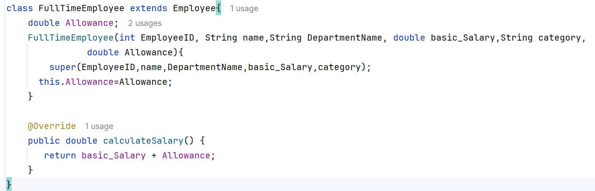
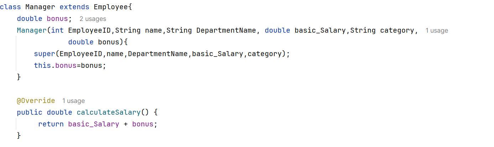
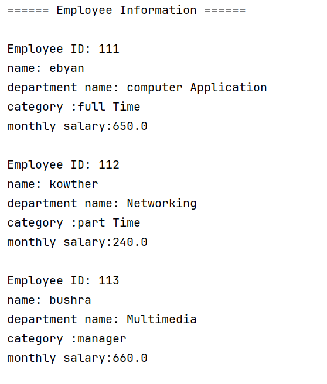

# Assignment 1: Inheritance and Polymorphism
**Employee Salary Management System**

**1. FullTimeEmployee code** — `code_fulltime.png`

Shows `FullTimeEmployee` extending `Employee`, using `super()`, and overriding `calculateSalary()` to return basic salary + allowance.

**2. PartTimeEmployee code** — `code_parttime.png`

Shows `PartTimeEmployee` extending `Employee`, using `super()`, and overriding `calculateSalary()` to return hours worked × hourly rate.

**3. Manager code** — `code_manager.png`

Shows `Manager` extending `Employee`, using `super()`, and overriding `calculateSalary()` to return basic salary + bonus.

### Output Screenshots (3)

**4. Full-Time output** — `output_fulltime.png`

Ahmed Ali (Full-Time Employee) earns $650.00.

**5. Part-Time output** — `output_parttime.png`

Fatima Hassan (Part-Time Employee) earns $240.00.

**6. Manager output** — `output_manager.png`

Mohamed Omar (Manager) earns $1200.00.

### Full Output (1)

**7. All output** — `output_all.png`

The complete salary report showing all three employees, stored in an `Employee[]` array and displayed through polymorphism.

---

## Answers

**1. Identify the superclass and subclasses.**
Superclass: `Employee`. Subclasses: `FullTimeEmployee`, `PartTimeEmployee`, and `Manager`.

**2. Explain how inheritance reduces code duplication.**
Common fields (ID, name, department, basic salary) and methods are written once in `Employee` and inherited by all subclasses. Each subclass only adds what is unique to it, so the code is shorter and easier to maintain.

**3. Identify the method that demonstrates polymorphism.**
`calculateSalary()`. It is overridden in each subclass, and when called on an `Employee[]` array, Java runs the correct version based on the actual object type.

**4. Explain why `@Override` is used.**
It tells the compiler that the method replaces a superclass method, so spelling or parameter mistakes are caught at compile time. It also makes the code clearer to read.

✅ 8. Conclusion

This assignment demonstrates inheritance, method overriding, and polymorphism in Java. It shows how different employee types can share common information while calculating their salaries differently.