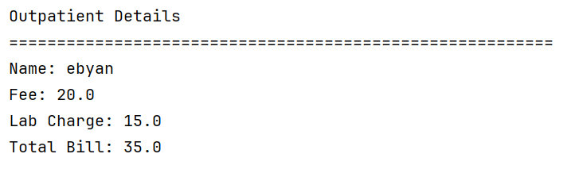
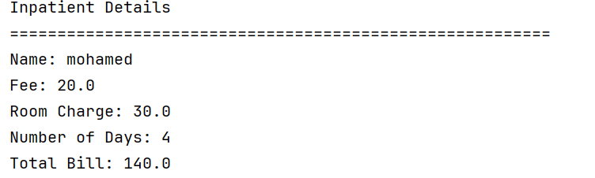

<h1> Hospital package</h1>

<h2>1. Outpatient Class </h2>

The Outpatient class inherits from the Patient class using extends. The super() keyword calls the parent class constructor. The CalculateBill() method adds the consultation fee and laboratory charge to calculate the total bill.

<h3> Formula: Consultation Fee + Lab Charge = Total Bill </h3>

⸻

<h2>2. Inpatient Class </h2>

The Inpatient class inherits from the Patient class. It uses super() to initialize the parent class properties. The CalculateBill() method multiplies the room charge by the number of days and adds the consultation fee.

<h3> Formula: (Room Charge × Number of Days) + Consultation Fee </h3>

