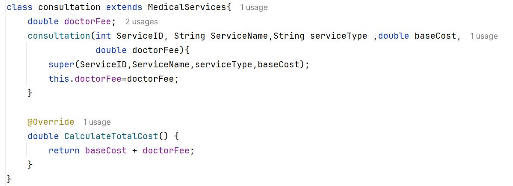
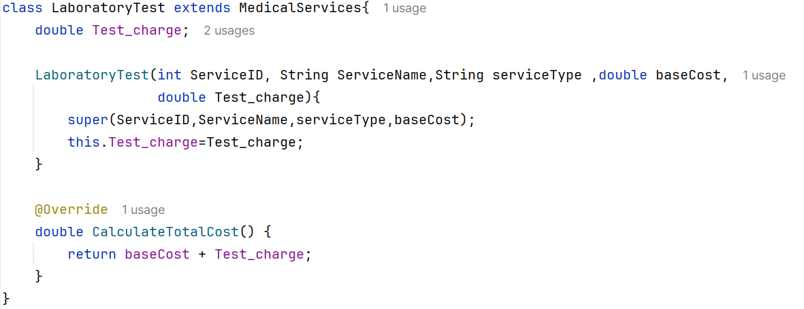
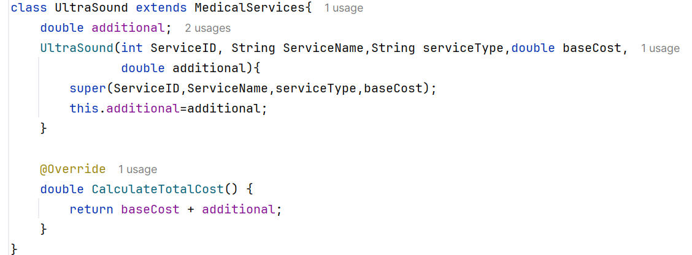
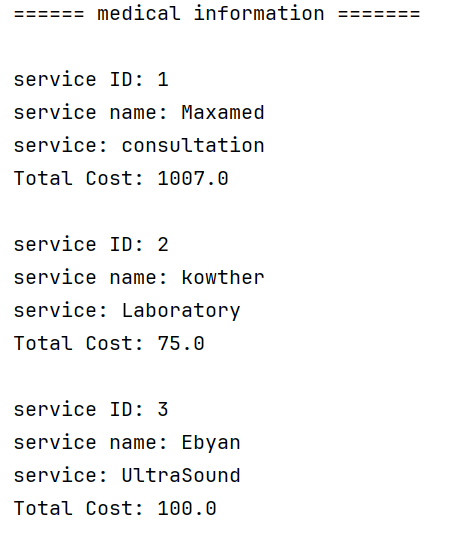

# Assignment 2: Abstract Class
**Hospital Medical Billing System**

### Code Screenshots (3)

**1. Consultation code**

Shows `Consultation` extending the abstract class `MedicalService`, using `super()`, and implementing `calculateTotalCost()` as base cost + doctor fee.

**2. LaboratoryTest code**

Shows `LaboratoryTest` extending `MedicalService`, using `super()`, and implementing `calculateTotalCost()` as base cost + test charge.

**3. Ultrasound code**

Shows `Ultrasound` extending `MedicalService`, using `super()`, and implementing `calculateTotalCost()` as base cost + additional fee.

### Output Screenshots (3)

**4. Consultation output**

Service 001 (Consultation) costs $1007.00.

**5. Laboratory Test output**

Service S002 (Laboratory Test) costs $75.00.

**6. Ultrasound output**

Service S003 (Ultrasound) costs $100.00.

### Full Output (1)

**7. All output**

The complete billing report showing all three services and the final Total Hospital Bill of $83.00.

---

## Answers

**1. Why is `MedicalService` declared abstract?**
Because it is a general idea, not a real service. It only holds the common data (ID, name, base cost) and forces all subclasses to follow the same structure, while each specific service calculates its own cost.

**2. Can an object be created directly from `MedicalService`? Explain.**
No. An abstract class is incomplete (it has an abstract method with no body), so Java gives a compile error if we write `new MedicalService(...)`. We can only create objects of its concrete subclasses, and use `MedicalService` as the reference type.

**3. What is the difference between an abstract method and a concrete method?**
An abstract method has no body (only a declaration, like `calculateTotalCost()`), and subclasses must implement it. A concrete method has a full body (like `displayServiceInfo()`), and subclasses can use it directly.

**4. Why must each concrete subclass implement `calculateTotalCost()`?**
Because the parent declares it as abstract without any code. A concrete subclass that does not implement it will not compile. This also makes sure every service has its own cost rule (doctor fee, test charge, or additional fee).

---

## Conclusion

This assignment showed how an abstract class works in Java. `MedicalService` defines the common structure and the abstract method `calculateTotalCost()`, while `Consultation`, `LaboratoryTest`, and `Ultrasound` each provide their own cost calculation. This approach reduces code duplication, enforces a consistent design, and makes the billing system easy to extend with new services. The program correctly produced a final hospital bill of $83.00.