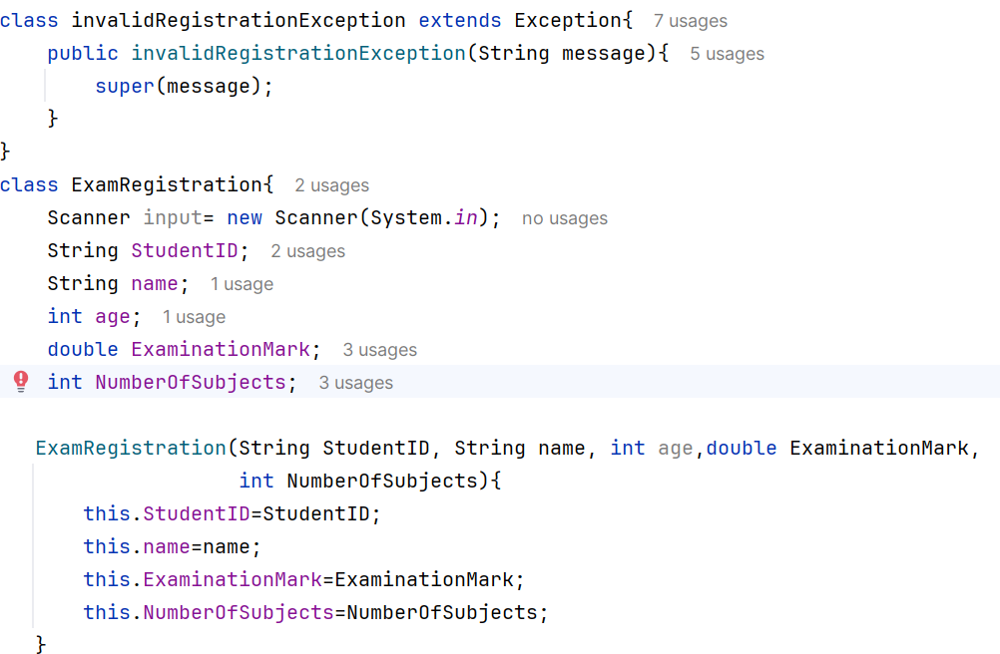
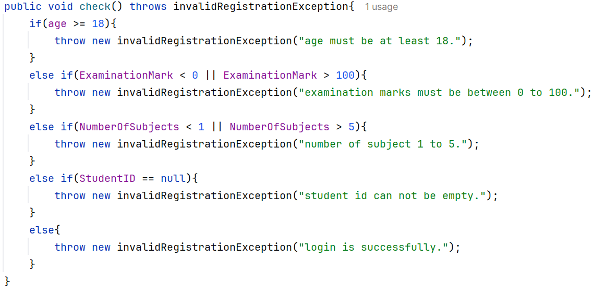
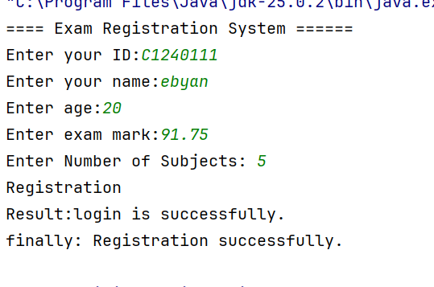

# University Exam Registration System

A Java console application that lets students register for examinations.
It validates input and uses exception handling so the program never
terminates unexpectedly.

## Files
- `InvalidRegistrationException.java` – custom checked exception
- `ExamRegistration.java` – main class (input, validation, output)
- `screenshots/` – images used in this README

## How to Run
```
javac InvalidRegistrationException.java ExamRegistration.java
java ExamRegistration
```

---

## Screenshot 1: Checked Exception

The custom exception `InvalidRegistrationException` extends `Exception`,
so it is a **checked exception**. The compiler forces us to handle it
with `try/catch` or declare it with `throws`.



---

## Screenshot 2: throws and throw

The `validate()` method declares `throws InvalidRegistrationException`
in its header, and uses `throw new ...` inside to raise the exception
when a rule is broken.



| Condition | Result |
|---|---|
| Student ID empty | Error: Student ID cannot be empty. |
| Age < 18 | Error: Age must be at least 18. |
| Mark < 0 or > 100 | Error: Exam mark must be between 0 and 100. |
| Subjects > 5 | Error: Maximum allowed subjects is 5. |
| Subjects < 1 | Error: Minimum number of subjects is 1. |
| Non-numeric input | Error: Please enter numbers only for age, mark and subjects. |

---

## Screenshot 3: Registration Result

Successful and failed registration outputs.



---

## Questions and Answers

**1. What is the purpose of try and catch?**
`try` holds code that may cause an error. `catch` handles it and shows a
clear message, so the program does not crash.

**2. Difference between throw and throws?**
`throw` actually throws an exception inside a method. `throws` is written
in the method header to declare that the method may throw an exception.

**3. What is the purpose of finally?**
`finally` always runs, whether or not an error occurred. It is used for
cleanup (closing the `Scanner`) and the final message.

**4. Why is a custom exception useful?**
It gives business rules (age, mark, subjects) a clear name, separates
registration errors from other errors, allows specific `catch` blocks, and
makes the code easier to maintain.